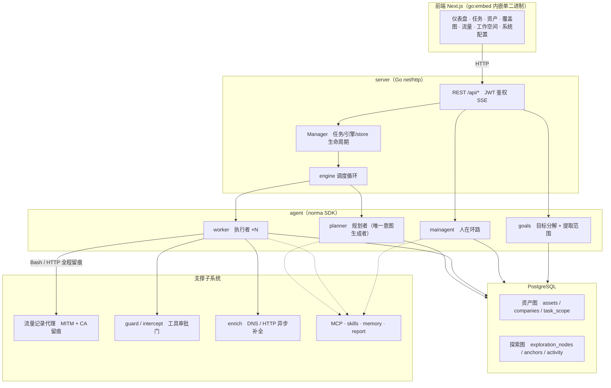
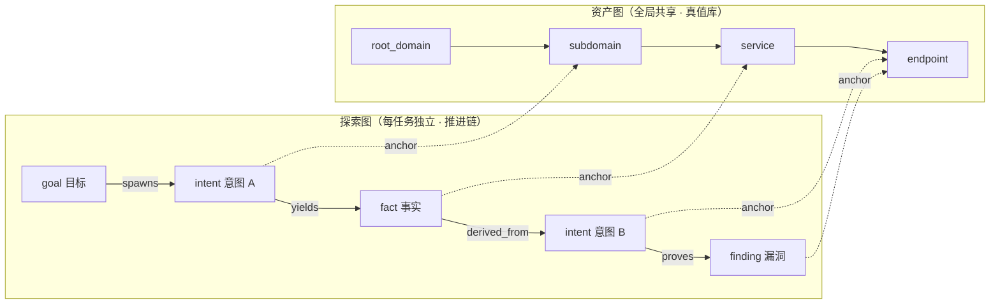
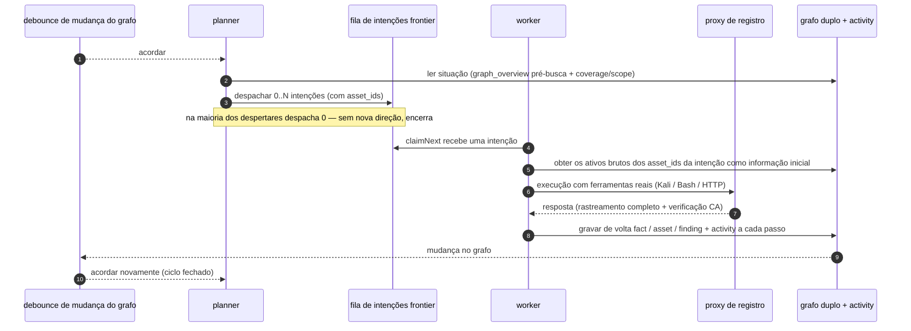
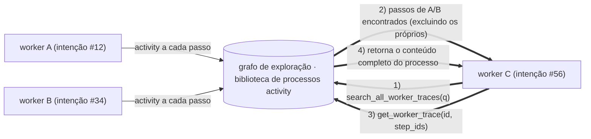
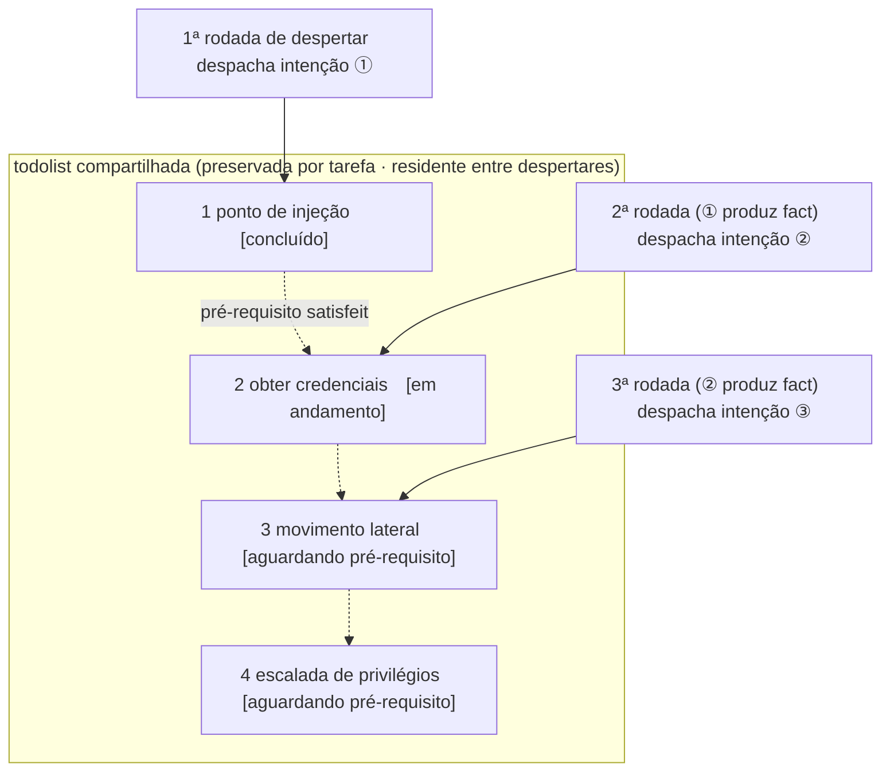

<div align="center">

# ARTEX

Sistema autônomo de testes de penetração com IA (backend em Go + frontend em Next.js)

<p>
  <a href="https://www.chainreactors.ai" target="_blank" rel="noopener noreferrer">
    
  </a>
</p>

🌐 **Demo online**: [https://artex-demo-ruoji6.vercel.app/](https://artex-demo-ruoji6.vercel.app/)

</div>

Este repositório ([RuoJi6/ARTEX](https://github.com/RuoJi6/ARTEX)) é um fork de [Autumn-27/ARTEX](https://github.com/Autumn-27/ARTEX), mantendo o histórico original de commits e a licença AGPL-3.0 do upstream, e agora é mantido continuamente pela [ChainReactors](https://www.chainreactors.ai). Os pacotes de lançamento do programa são baixados a partir das Releases deste repositório, e a imagem Docker [ruoji6/artex](https://hub.docker.com/r/ruoji6/artex) é construída e publicada pelo GitHub Actions deste repositório.

---
## Agradecimentos
Equipe de Segurança Mist

洺熙

wowo


## Prévia das capturas de tela

> Para a interação completa, consulte a [Demo online](https://artex-demo-ruoji6.vercel.app/).

| Painel (visão geral / consumo de Token / fluxo de atividades) | Lista de tarefas |
| :---: | :---: |
|  |  |

| Tarefa · Processo de execução (sessões / chamadas de ferramentas) | Cadeia de exploração |
| :---: | :---: |
|  |  |

| Descobertas | Ativos |
| :---: | :---: |
|  |  |

| Mapa de cobertura de ativos (layout direcionado por força · testados destacados · nós recolhíveis/expansíveis) |
| :---: |
|  |

| Gravação de tráfego | Conversa com humano no circuito |
| :---: | :---: |
|  |  |

| Gerenciamento de Agent | Configuração de LLM |
| :---: | :---: |
|  |  |

| Interceptação e aprovação | Logs do backend |
| :---: | :---: |
|  |  |


---

## Detalhes do registro de aprovação

O "Registro de aprovações" global, a "Interceptação e aprovação" dentro das tarefas e os cartões de aprovação nas conversas suportam expansão para visualizar detalhes. A estrutura de exibição é baseada no
[componente de detalhes de aprovação do AegisHook](https://github.com/RuoJi6/AegisHook/blob/main/web/src/components/CallDetail.vue), mantendo os componentes e o tema do ARTEX:


## Sincronização de ativos (ScopeSentry)

Suporta sincronização direta de dados de ativos a partir do [ScopeSentry](https://github.com/Autumn-27/ScopeSentry), eliminando a coleta duplicada:

- Na página "**Sincronização de ativos**", preencha o endereço e a API Key do ScopeSentry para conectar a fonte de dados;
- Selecione os alvos e tipos de ativos a sincronizar (domínio / subdomínio / IP / porta / site / endpoint…) por dimensão de **projeto** ou **tarefa**;
- Importe com um clique e mescle conforme o escopo de ativos da empresa, entrando diretamente no grafo de ativos do ARTEX para uso na exploração pelo agent.

---

## Implante sua própria Demo online (atualizada automaticamente com as Releases oficiais)

A Demo executa apenas o frontend `web/`, com `NEXT_PUBLIC_MOCK=1` habilitado na construção, sem necessidade de Go, PostgreSQL ou chaves de modelo. A interface usa dados simulados e não executa varreduras reais.

Fluxo de publicação: os pacotes do programa da versão oficial, o `SHA256SUMS` e a imagem Docker são todos publicados com sucesso → o job `demo` do `release.yml` chama o `demo.yml` → faz checkout do commit da tag dessa versão → constrói o frontend Mock → implanta no domínio de produção fixo da Vercel. Pushes comuns na main, criação apenas de tags, publicações com falha, rascunhos e versões de pré-lançamento não atualizam a Demo. Os dados de demonstração de novas funcionalidades ainda precisam ser mantidos de forma sincronizada pelos mantenedores em `web/src/lib/mock/`.

### Configuração inicial da Vercel

1. Crie um projeto vazio na sua conta da Vercel e defina o nome (por exemplo, `artex-demo-ruoji6`). Mantenha o **Git desconectado** para evitar implantações automáticas a cada commit. O `web/vercel.json` também desabilita a implantação automática via Git.
2. Em **Settings → Build and Deployment**, selecione **Next.js**, Node.js **22.x**, o comando de instalação pode ser substituído por `npm ci`, o comando de build como `npm run build`, e mantenha o Output Directory padrão. **Deixe o Root Directory vazio**: este workflow chama a Vercel CLI a partir do diretório `web/` já obtido no checkout, portanto não se deve preencher outra camada `web`.
3. Nas **Environment Variables** do projeto, adicione `NEXT_PUBLIC_MOCK=1`, aplicando ao menos em **Production**. Não defina `NEXT_EXPORT=1` nem preencha conexão de banco de dados ou chaves de modelo.
4. Em **Settings → General** do projeto, copie o **Project ID**; em **Settings → General** da equipe, copie o **Team ID** (correspondente a `VERCEL_ORG_ID`). Confirme que o domínio de produção a ser usado está em **Domains**.
5. Em **Account Settings → Tokens** da Vercel, crie um Token de implantação, selecionando o escopo da equipe onde o projeto está e definindo um prazo de validade adequado. Salve-o diretamente em **Settings → Secrets and variables → Actions → Secrets** do repositório GitHub, com o nome `VERCEL_TOKEN`. Não grave o token no repositório, no README ou em conversas; atualize este Secret após o vencimento.

Na mesma página de configurações do GitHub, em **Variables**, adicione:

| Variável | Valor |
| --- | --- |
| `VERCEL_ORG_ID` | Vercel Team ID |
| `VERCEL_PROJECT_ID` | Vercel Project ID |
| `DEMO_URL` | URL de produção pública fixa, incluindo `https://`, por exemplo `https://artex-demo-ruoji6.vercel.app` |

### Primeira implantação e nova tentativa

Após mesclar a configuração no branch padrão, abra **Actions → deploy-demo → Run workflow**, selecione o branch `main` e deixe a tag vazia ou preencha com a versão oficial mais recente atual (por exemplo, `v0.3.21`). O workflow aceita apenas a versão oficial mais recente já publicada que contenha os pacotes das cinco plataformas e o arquivo de verificação, e também consegue implantar versões oficiais históricas que ainda não incluíam este workflow. Não é necessário republicar uma Release nem mover tags existentes.

O workflow definirá o framework deste projeto dedicado de Demo como Next.js, Node como 22.x, o diretório raiz como vazio, o comando de instalação como `npm ci`, o comando de build como `npm run build`, garantirá `NEXT_PUBLIC_MOCK=1` no ambiente Production e, em seguida, vinculará o domínio especificado em `DEMO_URL`. Use um projeto independente; as implantações subsequentes continuarão mantendo essas configurações.

Após o sucesso, acesse o domínio de produção e verifique `tag`, `commit` e `mock: true` em `/demo-version.json`. Após confirmar o acesso, altere o link antigo da Demo no topo do README e na área de capturas de tela para o seu próprio domínio de produção.

A partir daí, basta publicar versões mais recentes pelo fluxo normal para atualizar a Demo automaticamente. Se a implantação da Demo falhar, os pacotes e imagens já publicados permanecem válidos e a Demo antiga normalmente continua em serviço; após corrigir as configurações, execute novamente apenas o `deploy-demo`, sem precisar republicar toda a Release. Quando duas versões são publicadas simultaneamente, as implantações são executadas em série, verificando o latest antes da construção e antes da entrada em produção, para evitar que uma construção desatualizada sobrescreva a versão mais recente.
Aqui está a tradução para o português brasileiro (pt-BR), preservando toda a formatação Markdown, blocos de código, termos técnicos, URLs e estrutura:

---

Aqui o fluxo de publicação chama diretamente o job de implantação, porque uma Release criada com `GITHUB_TOKEN` não dispara outro workflow `release: published`. O `demo.yml` também escuta Releases publicadas manualmente pela interface web e, após as mesmas verificações de versão oficial, pacote de publicação completo e latest, realiza a implantação; já a nova tentativa manual executa `deploy-demo`.

---

## Instalação

> Depende do banco de dados **PostgreSQL**; a exploração requer configuração de **LLM** (`ANTHROPIC_API_KEY` ou `OPENAI_API_KEY`, também configurável na UI).

### Opção 1: Script de instalação com um clique (recomendado)

```bash
git clone https://github.com/RuoJi6/ARTEX.git
cd ARTEX
./install.sh
```

O script irá: detectar / instalar automaticamente o Docker → permitir que você escolha **① Tudo em Docker** ou **② Compilação e execução local**:

- **① Tudo em Docker**: informe uma senha do Postgres (pode pressionar Enter para gerar aleatória) → grava automaticamente o `.env` → `docker compose up -d`.
- **② Execução local**: escolha o banco de dados (conectar a um existente / iniciar um com Docker) → gera o `config.json` → compila com `go` um binário único com frontend embutido → inicia.

Após a instalação, abra **http://localhost:8787** (no primeiro acesso, defina a senha de administrador em `/setup`).

### Opção 2: Docker Compose (manual)

```bash
git clone https://github.com/RuoJi6/ARTEX.git
cd ARTEX
cp .env.example .env          # preencha POSTGRES_PASSWORD, opcionalmente ANTHROPIC_API_KEY
docker compose up -d          # baixa a imagem ruoji6/artex + postgres
# → http://localhost:8787
```

A imagem já inclui ferramentas comuns (ripgrep/curl/vim/npm/nmap…); `./skills` e `./data` são persistidos via bind mount.

No `.env`, o padrão é `ARTEX_IMAGE=ruoji6/artex` e `ARTEX_TAG=latest` para usar a imagem mais recente, podendo ser fixado em `v0.3.17` (endereço completo da imagem `ruoji6/artex:v0.3.17`). A imagem suporta `linux/amd64` e `linux/arm64`; o Docker seleciona automaticamente a arquitetura compatível com o host, então o Kali ARM64 não precisa ser compilado manualmente. Na primeira implantação, altere o `POSTGRES_PASSWORD`; para executar o serviço não é necessário configurar o Token de publicação do Docker Hub.

O MCP remoto pode ser configurado nas configurações do sistema como `http` (Streamable HTTP) ou `sse` (SSE legado).
Serviços SSE legados geralmente usam `GET /sse` para estabelecer o fluxo de eventos e, em seguida, recebem requisições JSON-RPC pelo
`/message?sessionId=...` retornado pelo serviço; na configuração, preencha a URL como `/sse` e o cabeçalho de requisição como
`Authorization=Bearer <token>`.

### Opção 3: Baixar binário pré-compilado (Releases)

Acesse [Releases](https://github.com/RuoJi6/ARTEX/releases) deste repositório e baixe o zip da plataforma correspondente; após descompactar, você obtém `artex` + `start.sh` (no Windows, `start.bat`) + `skills/` + `config.example.json`. Para Linux ARM64 (incluindo Kali ARM64), escolha `linux-arm64`; para x86_64, escolha `linux-amd64`:

```bash
cp config.example.json config.json   # preencha a conexão com o database
./start.sh                           # → http://localhost:8787
```

> Inicie com `start.sh` / `start.bat`, e não executando `./artex` diretamente. Ele é um script supervisor: após o programa encerrar, decide com base no código de saída se deve reiniciá-lo, e **a [atualização com um clique](#opção-1-atualização-com-um-clique-na-página-recomendado) na página depende dele para realizar a troca**. Ao executar `./artex` diretamente, após a atualização ele não será reiniciado.
> Execução em segundo plano: `nohup ./start.sh >artex.log 2>&1 &`.

### Opção 4: Compilar binário único a partir do código-fonte

```bash
# 1) Exportação estática do frontend
cd web && npm ci && npm run build:static && cd ..
# 2) Criar diretório de embutimento
mkdir -p server/webui/dist
# 3) Copiar para o diretório de embutimento
cp -r web/out/. server/webui/dist
# 4) Compilar (somente com -tags embedui o frontend é embutido)
CGO_ENABLED=0 go build -tags embedui -o artex ./cmd/artex
./start.sh
```

### Opção 5: Construir pacotes zip de Release multiplataforma

O `build.sh` primeiro compila e embute o frontend, depois usa o linker do Go para remover informações de depuração e compacta os arquivos de publicação em zip. O modo Release gera por padrão pacotes zip para Linux amd64/arm64, macOS amd64/arm64 e Windows amd64:

```bash
./build.sh --release
# artefatos: dist/artex-0.3.3-*.zip
```

Binários autoextraíveis UPX podem ser incompatíveis com alguns kernels Linux, ambientes de virtualização ou políticas de segurança, por isso não são habilitados por padrão. Use `ARTEX_TARGETS` para personalizar os alvos; ao confirmar que o ambiente de execução de destino é compatível, você pode passar explicitamente `--upx` para reduzir ainda mais o binário:

```bash
ARTEX_TARGETS=linux/amd64,windows/amd64 ./build.sh --release
./build.sh --target linux/amd64 --upx
```

---

## Backup e migração com um clique

No cartão **Backup e migração** em **Configurações do sistema → Sistema e conta**:

- **Baixar backup**: gera um único `artex-backup-<horário>.tar.zst`, salvo diretamente pelo navegador. Antes de exportar, é necessário pausar ou aguardar a conclusão de todas as tarefas em execução/na fila, para evitar inconsistências causadas por gravações de arquivos durante a exportação. O conteúdo inclui todas as tabelas de negócio do PostgreSQL (exportação em streaming fragmentado dentro da mesma transação de snapshot, consistente entre tabelas), o diretório de dados (workspaces de tarefas, sessões, evidências, pacotes de arquivamento de tarefas, certificados MITM CA, tráfego e seu snapshot de índice SQLite) e o diretório skills. Não inclui os logs de execução do sistema (`server_logs`) nem o `jwt.key`.
- **Restaurar a partir de backup**: na nova máquina, primeiro instale e inicie o ARTEX normalmente, faça login e envie o arquivo de backup. O servidor primeiro descompacta completamente e valida conforme a estrutura atual do banco de dados; após aprovação, reinicia; ao reiniciar, substitui os dados antes que qualquer componente os abra: o banco de dados é substituído integralmente em uma única transação (em caso de falha, os dados originais permanecem inalterados e o pacote de restauração é movido para `data/.restore-failed` para investigação), e o diretório de dados é substituído item a item; se a substituição de arquivos falhar, o processo encerra com código não zero e o script supervisor tenta novamente, até que toda a substituição seja concluída antes de iniciar o motor de negócio. O cartão exibe o resultado da última restauração.
- A restauração **sobrescreve todos os dados da instância atual** e reinicia, interrompendo as tarefas em execução; tarefas não concluídas no backup permanecerão pausadas após a restauração e precisarão ser retomadas manualmente, não continuando automaticamente a enviar requisições aos alvos na nova máquina. Senha de login, Basic Auth, LLM e outras configurações migram junto com o banco de dados; após a restauração, faça login com a senha da instância original.
- Skills com o mesmo nome já existentes na nova máquina mantêm a versão local (para evitar que backups antigos sobrescrevam skills internas mais recentes); os demais skills são instalados a partir do backup.
- Só é possível restaurar para uma versão do ARTEX **igual ou mais recente**; se o backup contiver tabelas ou colunas desconhecidas pela versão atual, a restauração será recusada. Caminhos antigos (como caminhos absolutos de pacotes de arquivamento de tarefas) são automaticamente reescritos para o novo diretório de dados.
- A restauração depende do `start.sh` / `start.bat` (no Docker, o ENTRYPOINT da imagem) para reiniciar o programa, assim como a atualização com um clique na página.
- Durante a restauração, é necessário reservar espaço temporário adicional no disco onde está o diretório de dados, aproximadamente do tamanho de um **pacote de backup não compactado** (texto do banco de dados e arquivos após descompactação); se houver um proxy reverso Nginx na frente, amplie o `client_max_body_size` para `/api/system/backup/` e desative o `proxy_request_buffering` conforme o exemplo de proxy reverso abaixo.

## Atualização e upgrade

> O upgrade apenas troca o programa, sem tocar nos dados: o volume de dados do Postgres `pgdata`, `./data` (jwt.key / SQLite etc.) e `./skills` são preservados. **A migração do banco de dados não precisa ser executada manualmente** — o `artex` reexecuta de forma idempotente o `schema.sql` a cada inicialização (incluindo `ADD COLUMN` / `CREATE INDEX IF NOT EXISTS`), ou seja, "reiniciar é migrar". Ainda assim, recomenda-se fazer backup de `./data` e do banco de dados antes do upgrade.

### Opção 1: Atualização com um clique na página (recomendado)
Na página **Configurações do Sistema** (barra lateral "Configurações do Sistema" → `/system/settings`), no cartão **Versão e Atualizações**, é possível verificar e instalar novas versões diretamente, sem precisar acessar o servidor.

O programa compilado neste repositório verifica atualizações fixamente a partir do Release oficial mais recente do GitHub em `RuoJi6/ARTEX`, ignorando rascunhos e versões pré-lançamento. O programa oficial antigo ainda aponta para o repositório do autor original, portanto a primeira troca exige a instalação manual do programa compilado neste repositório; a partir daí, basta publicar uma versão de três segmentos mais alta para atualizar pela página. Apenas enviar para a main ou criar uma tag Git sem publicar um Release não gera uma nova versão instalável online.

Após clicar em "Atualizar": baixa o pacote de release da plataforma atual → compara com o `SHA256SUMS` do Release → executa um teste rápido do novo binário com `-h` → armazena temporariamente como `artex.new` → o programa encerra, e o `start.sh` / `start.bat` o reinicia e conclui a substituição. A página aguarda automaticamente até que a nova versão esteja no ar e então atualiza.

- **Falhas não deixam um programa defeituoso**: se a verificação ou o teste rápido falhar, o arquivo temporário é descartado e a versão atual continua em execução; se a nova versão, após a substituição, falhar 3 vezes consecutivas ao iniciar, ela reverte automaticamente para `artex.old` (a versão que falhou é mantida como `artex.failed` para diagnóstico).
- **Reversão a qualquer momento**: a versão anterior é mantida como `artex.old`, e o cartão possui "Reverter para a versão anterior". Observe que a estrutura do banco de dados não reverte.
- **A atualização interrompe tarefas em execução** — atualizar significa reiniciar, então faça isso em momentos ociosos.
- **Compilações de desenvolvimento não recebem atualizações**: desabilitado quando o número de versão é `dev` ou quando `git describe` possui sufixo, para evitar que a versão oficial sobrescreva o binário de depuração local.
- **No Docker, apenas o programa é substituído, não a imagem**: as ferramentas da imagem, como playwright / nmap, não são atualizadas junto, e após reconstruir o contêiner com `docker compose up -d`, ele volta para a versão incluída na imagem. Para atualizar também a imagem, continue usando `docker compose pull artex && docker compose up -d artex`.
- **Proxy de atualização (opcional)** usa o mesmo método de "campo de endereço + salvar" das demais configurações de proxy. Preencha um proxy de atualização independente e salve, por exemplo `http://127.0.0.1:7897`; suporta `http://`, `https://`, `socks5://`, `socks5h://` e autenticação com usuário e senha. Limpar e salvar significa conexão direta, sem influência do proxy global ou das variáveis de ambiente `HTTP_PROXY` / `HTTPS_PROXY`. Após salvar, a verificação é refeita automaticamente; a verificação de versão, a verificação de checksum e o download do pacote de release usam a mesma saída. A atualização baixa apenas de domínios do GitHub e força HTTPS.
- O endereço do proxy é acessado pelo **servidor ARTEX**. O `127.0.0.1` dentro do Docker refere-se ao próprio contêiner; se o proxy estiver rodando no host, deve-se usar um endereço acessível pelo contêiner (no Docker Desktop, geralmente `http://host.docker.internal:7897`), e permitir que o contêiner acesse a porta do proxy.

### Mantenedores: publicar atualizações online via GitHub Actions

O fluxo de trabalho de publicação é `.github/workflows/release.yml`. O envio de uma tag oficial dispara a compilação; também é possível, em Actions → release → Run workflow, inserir uma tag existente para reexecutar uma publicação que falhou. A tag deve ser `vversão_principal.versão_secundária.versão_de_revisão`, por exemplo `v0.3.17` no exemplo abaixo; versões subsequentes devem ser superiores à versão que o usuário está executando.

```bash
git push origin main
git tag v0.3.17
git push origin v0.3.17
```

O fluxo de trabalho fixa o commit correspondente à tag, exporta o frontend com Node.js 22, compila os programas das cinco plataformas com o frontend embutido usando a versão do Go especificada em `go.mod`, e gera o ZIP e o `SHA256SUMS`. As imagens AMD64 e ARM64 são compiladas em runners nativos do GitHub, conectam-se a um PostgreSQL temporário para validar a inicialização do programa, a versão e o frontend embutido; após ambas as arquiteturas passarem, publica a tag de versão e o `latest` da imagem multiarquitetura. Após a publicação bem-sucedida da imagem, envia o ZIP completo e o arquivo de checksum, e por fim torna o Release público. A mesma versão já pública não pode ser sobrescrita; deve-se publicar uma nova tag.

Os mantenedores precisam configurar, em Settings → Secrets and variables → Actions deste repositório, a variável `ARTEX_DOCKER_IMAGE` (nome de usuário/nome da imagem no Docker Hub) e os Secrets `DOCKERHUB_USERNAME`, `DOCKERHUB_TOKEN` (com permissão de push de imagem). O pacote do programa é enviado pelo `GITHUB_TOKEN` nativo do GitHub, e a imagem é enviada ao Docker Hub com as credenciais acima. As credenciais são usadas apenas para login no fluxo de trabalho, não sendo gravadas no código-fonte ou na imagem. O endereço da imagem também é registrado em `.env.example` e nos valores padrão do Compose.

### Migrar uma implantação Docker existente para a imagem deste repositório

No diretório da implantação original, faça backup do `.env`, do arquivo Compose, de `data/` e dos dados do PostgreSQL, mantendo o volume do banco de dados original e a montagem de skills. Defina `ARTEX_IMAGE` no `.env` como o endereço da imagem deste repositório e `ARTEX_TAG` como a versão de destino; se o Compose antigo ainda fixar a imagem do autor original, crie o seguinte arquivo de override (se já existir um arquivo de override, mescle a configuração de image):

```yaml
# docker-compose.override.yml
services:
  artex:
    image: ${ARTEX_IMAGE}:${ARTEX_TAG:-latest}
```

Em seguida, atualize apenas o contêiner da aplicação:

```bash
docker compose pull artex
docker compose up -d --no-deps artex
curl --fail http://127.0.0.1:8787/api/health
docker compose logs --tail=50 artex
```

Continue usando o diretório da implantação original e o nome do projeto Compose, garantindo que `./data`, `./skills` e o volume de dados do PostgreSQL ainda apontem para os dados originais. Após a migração, o programa verifica atualizações online a partir de `RuoJi6/ARTEX`; posteriormente, é possível atualizar o programa pela página ou atualizar a imagem inteira com os comandos acima.

Na primeira migração de uma implantação Docker existente, extraia o novo ZIP ARM64 já verificado no host, faça backup do programa original e então substitua apenas o `/app/artex` no contêiner existente. Por exemplo, se o contêiner atual se chama `artex-artex-1`:

```bash
# Execute no diretório de download; primeiro verifique o ZIP baixado com SHA256SUMS e depois extraia.
sha256sum --ignore-missing --check SHA256SUMS
unzip artex-0.3.17-linux-arm64.zip
sudo docker stop artex-artex-1
sudo docker cp artex-artex-1:/app/artex ./artex-before-migration
sudo docker cp ./artex-0.3.17-linux-arm64/artex artex-artex-1:/app/artex
sudo docker start artex-artex-1
curl --fail http://127.0.0.1:8787/api/health
```

Isso preserva o banco de dados existente e as montagens de data e skills. Acesse a página de configurações do sistema para verificar a fonte de atualização e a versão. O programa substituído dentro do contêiner ainda pertence à camada gravável do contêiner; excluir ou reconstruir o contêiner perderá o resultado da substituição; quando for necessário reconstruir, deve-se usar uma imagem que contenha o programa deste repositório. A reversão do programa não reverte as migrações do banco de dados; faça backup do banco de dados e de data antes de atualizar.

### Método 2: script de atualização com um clique

```bash
cd ARTEX
./update.sh
```

O script primeiro executa opcionalmente `git pull` para obter o código mais recente, e então permite escolher **① Atualização Docker** ou **② Atualização por compilação local** (correspondente ao `install.sh`):

- **① Docker**: permite especificar a tag da imagem de destino (Enter mantém o `ARTEX_TAG` do `.env`, padrão `latest`) → `docker compose pull` → `docker compose up -d` (reiniciar com a nova imagem executa a migração automaticamente).
- **② Local**: reconstrói os artefatos estáticos do frontend → recompila `./artex` (após concluir, reinicie o processo para aplicar).

### Método 3: Docker Compose (manual)

```bash
cd ARTEX
git pull                       # Atualizar compose / scripts (opcional)
# Especificar versão: definir ARTEX_TAG=v0.3.17 no .env; se não definido, usa latest
docker compose pull artex
docker compose up -d artex     # Reiniciar com a nova imagem → migração automática do schema
docker image prune -f          # Limpar imagens antigas (opcional)
```

### Método 4: binário pré-compilado (Releases)

Acesse [Releases](https://github.com/RuoJi6/ARTEX/releases), baixe o zip da nova versão, pare o processo antigo e substitua `artex` e `skills/` (mantendo seu `config.json` e `data/`), e reinicie:

```bash
```
cp -r <diretório descompactado>/skills ./ && cp <diretório descompactado>/artex ./
./start.sh
```

### Método 5: Compilar a partir do código-fonte

```bash
git pull
cd web && npm ci && npm run build:static && cd ..
mkdir -p server/webui/dist
cp -r web/out/. server/webui/dist
CGO_ENABLED=0 go build -tags embedui -o artex ./cmd/artex
# Reinicie ./start.sh
```

---

## Configuração

**Banco de dados** (`config.json`, ou sobrescreva com a variável de ambiente `ARTEX_PG_DSN`):

```json
{
  "database": {
    "host": "127.0.0.1", "port": 5432,
    "user": "artex", "password": "yourpass",
    "dbname": "artex", "sslmode": "disable"
  }
}
```

**LLM**: `export ANTHROPIC_API_KEY=sk-...` (ou `OPENAI_API_KEY`), também pode ser preenchido na página "Configuração de LLM" da UI.
Opcional: `ARTEX_LLM_PROVIDER` / `ARTEX_LLM_MODEL` / `ARTEX_LLM_BASE_URL` / `ARTEX_LLM_PROXY`.

**HTTP User-Agent**: O WebFetch integrado (worker / planner / main / chat), o preenchimento automático de HTTP de ativos, a sondagem de conectividade de saída, as ferramentas HTTP personalizadas, o reprodutor de requisições, a auto-atualização do GitHub e os opcionais `harvest_static.py` / `spider_mpa.py` selecionam aleatoriamente, por padrão, a partir de 20 amostras de UA de navegadores, sem carregar o nome da ferramenta. O Go seleciona uma vez por requisição lógica, e redirecionamentos e novas tentativas de conexão direta após falha de proxy do WebFetch reutilizam o mesmo valor; os scripts Python selecionam uma vez por execução, mantendo consistência entre entrada, download e novas tentativas. A seleção aleatória permite repetição e não depende de serviços de IA. Através de `ARTEX_HTTP_USER_AGENT` é possível especificar um valor fixo; valores vazios ou inválidos usam a estratégia aleatória. Ao executar diretamente, exporte a variável de ambiente e reinicie o serviço; no Docker, configure no `.env` e recrie o contêiner. O `--user-agent VALUE` do Python, UAs explícitos em ferramentas personalizadas e no reprodutor têm prioridade, e valores explicitamente vazios ainda podem omitir este cabeçalho. O valor tem espaços no início e no fim removidos e aceita apenas ASCII imprimível. O registro de proxy preserva o UA existente e a semântica de omissão explícita. A randomização de UA não significa que TLS, Cookie ou outras características do navegador mudem em sincronia, nem garante que o cliente não seja identificável. Esta configuração não afeta navegadores, busca na internet via SDK, comunicação com serviços LLM / MCP / Webhook ou ferramentas externas independentes; este repositório não inclui o phpfinger, cujo `--user-agent` precisa ser configurado separadamente nessa ferramenta.

O escopo completo de verificação, descobertas adicionais e comunicações de serviços não cobertas estão em [Verificação de Identificação de Requisições HTTP](HTTP_USER_AGENT.md).

**Concorrência**: O número de work agents por tarefa é configurado em "Configurações do Sistema" (padrão 3).

**Parâmetros comuns**: `./start.sh -addr :8787 -proxy :8788` (`-addr` frontend+API, `-proxy` proxy de gravação de tráfego). O script de inicialização repassa os parâmetros como estão para o `artex`.

### Autenticação de acesso HTTP Basic Auth opcional

Em **Configuração do Sistema → HTTP Basic Auth**, preencha um nome de usuário e senha de verificação independentes, ative "Habilitar verificação de acesso" e clique em "Salvar verificação de acesso". Desativado por padrão, entra em vigor imediatamente após salvar, sem necessidade de reiniciar; a senha deve ter pelo menos 8 caracteres e no máximo 72 bytes, e o nome de usuário não pode conter dois-pontos.

Quando ativado, os visitantes primeiro completam a autenticação nativa de usuário e senha do navegador e depois entram na página de login original do ARTEX. Páginas web, recursos estáticos e APIs são todos protegidos (exceto o endpoint `/mcp` do servidor MCP: ele não passa pelo Basic Auth e não pode ser acessado com usuário e senha Basic, aceitando apenas tokens de acesso, veja "Servidor MCP" abaixo), e a verificação de saúde GET/HEAD de `/api/health` também requer Basic Auth, retornando `401` quando não autenticado; após passar, retorna apenas `{"ok":true}`, sem expor o nome ou a versão da aplicação. A verificação de saúde não exige adicionalmente JWT de administrador; sondas externas precisam configurar as mesmas credenciais Basic Auth, por exemplo usando `curl --fail --user 'nome de usuário de verificação' http://127.0.0.1:8787/api/health` e digitando a senha quando solicitado. Quando o Basic Auth não está ativado, mantém-se o comportamento original de verificação de atividade sem credenciais. O número da versão é fornecido por `/api/version`, que requer JWT de administrador, e após ativar a verificação de acesso essa interface também fica protegida pelo Basic Auth. O realm do Basic Auth para requisições não autenticadas usa o nome genérico `Restricted`; após passar pela verificação de acesso, ainda é necessário fazer login no ARTEX para usar as APIs de negócio. Para implantação em rede pública, acesse via HTTPS.

Ao atualizar de uma versão antiga da página web que ainda usa `/api/health` para ler a versão para esta versão, a página antiga pode não conseguir determinar automaticamente que a atualização foi concluída; após reiniciar o serviço, basta atualizar a página manualmente. A exibição de versão e o polling de atualização da nova página web usam `/api/version`.

A configuração é persistida no banco de dados, a senha é armazenada apenas como hash bcrypt e a interface não a exibe. Ao salvar, deixar a senha em branco significa não modificá-la; após desativar, as credenciais são mantidas para facilitar a reativação. O Cookie de verificação HttpOnly independente tem validade de 12 horas e é compatível com o JWT e SSE existentes. Quando a verificação expira, as requisições em segundo plano acionam a reverificação da página atual, preservando o estado de login do ARTEX, sem necessidade de abrir uma nova aba; salvar a configuração invalida os Cookies de verificação antigos de outros navegadores, mantendo o acesso do navegador do administrador atual. O navegador pode armazenar em cache as credenciais do Basic Auth; use uma nova janela anônima para verificar o popup de verificação.

Docker e o binário de frontend embutido suportam diretamente este recurso. A verificação de autenticação do `next dev` encaminha credenciais apenas para o backend de loopback local (`localhost`, `127.0.0.1` ou `::1`); o frontend e o backend devem usar o mesmo nome de host. O backend de desenvolvimento remoto ainda pode ser usado quando a verificação não está ativada; quando ativada, acesse o serviço remoto através do frontend embutido para evitar problemas de Cookie de verificação entre domínios.

Se a senha de verificação independente for esquecida, conecte-se ao banco de dados da aplicação no servidor, execute a instrução abaixo e reinicie o ARTEX para desativar esta camada de verificação de acesso, depois faça login com a conta ARTEX original e reconfigure:

```sql
UPDATE settings
SET value = jsonb_set(value::jsonb, '{enabled}', 'false'::jsonb)::text,
    updated_at = now()
WHERE key = 'auth.http_basic';
```

### Servidor MCP (para agentes externos orquestrarem tarefas)

O ARTEX pode atuar como servidor MCP, permitindo que agentes externos (assistentes pessoais, bots, etc.) visualizem tarefas e vulnerabilidades, criem tarefas, pausem ou retomem tarefas.

Atenção à distinção: a página "Sistema → MCP" gerencia os MCPs externos que os próprios agents do ARTEX **chamam**; este documento trata do endpoint MCP que o ARTEX **fornece** externamente.

#### Ativação e integração

1. Em "Configurações do Sistema → Sistema e Conta → Servidor MCP", ative o interruptor. Desativado por padrão; quando desativado, `/mcp` retorna 404.
2. No mesmo local, clique em "Criar token" e selecione o escopo de permissões. O token é exibido apenas uma vez.
3. Configure no agente:

| Item | Valor |
| --- | --- |
| Endereço | `https://<seu endereço ARTEX>/mcp` |
| Transporte | Streamable HTTP (sem estado, responde apenas `application/json`, não fornece SSE, não suporta stdio) |
| Autenticação | Cabeçalho `Authorization: Bearer artex_mcp_...` |

```bash
curl -s https://artex.example.com/mcp \
  -H 'Authorization: Bearer artex_mcp_xxx' -H 'Content-Type: application/json' \
  -d '{"jsonrpc":"2.0","id":1,"method":"tools/list"}'
```

#### Não é possível usar HTTP Basic Auth

`/mcp` **não passa** pela verificação HTTP Basic Auth e **não aceita** usuário e senha Basic, senha de login do ARTEX ou JWT após login de administrador, aceitando apenas tokens de acesso.

Motivo: uma requisição HTTP tem apenas um cabeçalho `Authorization`, e agentes externos não podem enviar simultaneamente credenciais Basic e token Bearer. Portanto:

- Mesmo com HTTP Basic Auth ativado, `/mcp` ainda pode ser acessado diretamente com token de acesso, e o Basic Auth não adiciona uma camada de proteção a ele.
- Se for necessário restringir quem pode conectar a `/mcp`, use a "Lista de permissões de origem" abaixo, não dependa do Basic Auth.
- Para exposição em rede pública, use HTTPS, pois o token é enviado em texto claro no cabeçalho da requisição.

#### Lista de permissões de origem

No cartão "Servidor MCP", no campo "Lista de permissões de origem", preencha os endereços de origem permitidos para chamar `/mcp`, um IP ou CIDR por linha (como `203.0.113.7`, `10.0.0.0/8`, com suporte a IPv6). Deixar em branco significa não restringir a origem.
- A lista de permissões é verificada antes do token: origens que não estão na lista são rejeitadas mesmo com um token válido, retornando `403`, e a resposta inclui o endereço de origem visto pelo servidor, para facilitar a investigação.
- A lista de permissões se aplica apenas a `/mcp`, não afeta a página web nem a API de administração; um erro de preenchimento não deixará você bloqueado fora do painel.
- **Implantado atrás de um proxy reverso**: nesse caso, o endereço de conexão direta é sempre o proxy. É necessário preencher o endereço do proxy em "Proxy confiável" para que o ARTEX passe a usar o endereço em `X-Forwarded-For` como origem (pegando da direita para a esquerda o primeiro endereço que não pertence a um proxy confiável). Sem proxy confiável configurado, esse cabeçalho é sempre ignorado, evitando que o chamador falsifique a origem. O proxy precisa anexar a origem real a esse cabeçalho, por exemplo, no nginx: `proxy_set_header X-Forwarded-For $proxy_add_x_forwarded_for;`.
- O cartão exibe "o endereço de origem atual que o servidor vê", que pode ser usado para confirmar se o proxy confiável está configurado corretamente.

#### Escopos de permissão e ferramentas

O token só pode ver e chamar ferramentas dentro do seu escopo de permissão.

| Escopo de permissão | Ferramenta | Descrição |
| --- | --- | --- |
| `read` | `list_tasks` | Lista tarefas, filtráveis por `company_id`, `category_id`, `status` |
| `read` | `get_task` | Status, tempo de execução, número de metas concluídas e número de vulnerabilidades de uma tarefa; use para consultar o progresso |
| `read` | `get_task_graph` | Visão geral do grafo de exploração da tarefa |
| `read` | `list_task_findings` | Vulnerabilidades confirmadas da tarefa (sem tráfego bruto de requisição/resposta) |
| `read` | `list_companies` / `list_task_categories` / `list_llm_profiles` | Empresas, categorias e configurações de modelo disponíveis ao criar tarefas (sem API Key) |
| `task:create` | `spawn_task` | Cria e inicia uma tarefa, podendo incluir `company_ids`, `category_id` |
| `task:control` | `pause_task` / `resume_task` / `add_task_hint` | Pausar, retomar, adicionar dica |

O ARTEX não possui uma entidade independente de "projeto". O que o agente chama de "um projeto" corresponde a um conjunto de tarefas sob uma empresa ou uma categoria de tarefa.

Capacidades não expostas: criar/alterar ferramentas personalizadas, MCP, skill, leitura/escrita de arquivos do workspace, chaves de LLM, configurações do sistema.

#### Restrições do token

- **Empresas limitadas**: quando marcado, o token só pode criar tarefas sob essas empresas (deve incluir `company_ids`, e o endereço de destino deve pertencer ao escopo dessas empresas), e só pode ver e controlar tarefas dessas empresas; as demais tarefas aparecem como inexistentes para ele. Isso vincula a tarefa ao escopo de ativos da empresa, não é uma interceptação em nível de rede; para limitar rigidamente o que a tarefa pode acessar, use em conjunto com regras de interceptação de ativos.
- **Limite de tarefas não encerradas**: número de tarefas criadas por esse token que ainda não foram encerradas (incluindo pausadas e na fila).
- **Limite de criação de tarefas por hora**: contado pelo número de tarefas criadas por esse token na última hora; tarefas excluídas ainda contam.
- **Validade** e **revogação**: a revogação tem efeito imediato e é irreversível.

#### Auditoria

Cada chamada de ferramenta é registrada: token, ferramenta, parâmetros, se teve sucesso, motivo da falha, endereço de origem, horário, incluindo chamadas rejeitadas por permissão insuficiente. Consulte em "Auditoria de chamadas" na página de configurações; são mantidos os 20.000 registros mais recentes.

#### Dicas de segurança

- Criar tarefas dispara testes de segurança reais contra o alvo; entregue tokens `task:create` apenas a agentes confiáveis e, na medida do possível, limite empresas e defina cotas.
- Conteúdos retornados, como descrições de tarefas e resumos de vulnerabilidades, podem conter texto proveniente do alvo testado; para o agente, são entradas não confiáveis e podem carregar injeção de prompt.
- Requisições de navegador de origem cruzada com cabeçalho `Origin` são rejeitadas (403); `/mcp` não envia cabeçalhos CORS.

### Implantação com proxy reverso (HTTPS / expor apenas a 443)

O frontend e a API/SSE são servidos pela mesma porta do backend (padrão `:8787`); o fluxo de atividades em tempo real usa por padrão o endereço **de mesma origem**, portanto **não é necessário configurar `NEXT_PUBLIC_SSE_BASE`**; basta expor apenas a 443 publicamente e manter a 8787 na rede interna.

SSE é uma conexão longa com envio contínuo; o proxy reverso **deve desativar o buffering**, caso contrário o navegador consegue conectar mas não recebe eventos (o fluxo de atividades fica girando indefinidamente). Exemplo com Nginx:

```nginx
server {
    listen 443 ssl;
    server_name your.domain.com;
    # ssl_certificate / ssl_certificate_key ...

    location / {
        proxy_pass http://127.0.0.1:8787;
        proxy_set_header Host $host;
        proxy_set_header X-Forwarded-Proto $scheme;

        # Itens essenciais para SSE: desativar buffering, timeout longo, HTTP/1.1
        proxy_buffering off;
        proxy_cache off;
        proxy_read_timeout 3600s;
        proxy_http_version 1.1;
        proxy_set_header Connection "";
    }

    # Backup / restauração em um clique: permite upload e download de backups grandes em streaming, evitando o limite padrão de 1m e o buffering do corpo da requisição
    location /api/system/backup/ {
        proxy_pass http://127.0.0.1:8787;
        proxy_set_header Host $host;
        proxy_set_header X-Forwarded-Proto $scheme;

        client_max_body_size 0;
        proxy_request_buffering off;
        proxy_buffering off;
        proxy_cache off;
        proxy_read_timeout 3600s;
        proxy_send_timeout 3600s;
        proxy_http_version 1.1;
        proxy_set_header Connection "";
    }
}
```

> Somente quando o SSE precisar usar uma origem diferente da página (como um subdomínio independente), defina `NEXT_PUBLIC_SSE_BASE` em **tempo de build** (essa variável é fixada no pacote estático durante `next build`; defini-la em tempo de execução do contêiner não tem efeito).

---


## Desenvolvimento

### Mesclagem da mesma vulnerabilidade e relatório unificado

A página de descobertas usa por padrão "por vulnerabilidade". Os relatórios brutos, por tarefa e por ativo mantêm as tabelas, status e botões de ação originais; apenas os registros mesclados passam a ser pastas de vulnerabilidade expansíveis. Dentro da mesma tarefa, o Reporter forma uma pasta após confirmar, com base no alvo, parâmetros da interface, limites de permissão, causa raiz e evidências de verificação, que se trata do mesmo defeito real; apenas o tipo ou o nome iguais não servem como base para mesclagem automática. Gravidade, interface, backend ou impacto de leitura/escrita diferentes ainda podem ser a mesma vulnerabilidade; por outro lado, compartilhar a mesma entrada de login ou token não prova sozinho a mesma causa raiz. Quando houver relação mas a causa raiz comum não puder ser confirmada, é enviada uma sugestão para revisão manual. As contagens `Crítica/Alta/Média/Baixa` da pasta são calculadas com base nos registros brutos, por exemplo `0/1/1/1`; o número de vulnerabilidades independentes na página de descobertas é deduplicado por pasta, e as contagens por nível são calculadas com base nos relatórios brutos; a lista e os detalhes da pasta não exibem rótulos de classificação unificada. O conteúdo dos relatórios brutos, a classificação, o status, o relatório e as evidências não são sobrescritos.

Clique na seta para expandir os registros brutos; clique no título da pasta para ver o relatório unificado, os registros brutos e o histórico de mesclagem. Sugestões com evidências insuficientes exigem clicar em "Confirmar mesclagem"; após rejeitar ou remover, essas relações não serão mescladas automaticamente novamente pelo Agent. Remover um membro não exclui a vulnerabilidade original; com menos de dois, a pasta é dissolvida e o histórico é preservado. Grupos de vulnerabilidade de tarefas herdadas permanecem somente leitura.

Novos relatórios são processados pelo Reporter existente, que gera um relatório independente e verifica duplicatas. A atualização adiciona pela primeira vez as ferramentas de mesclagem e as instruções de execução do Reporter, preservando prompts personalizados e configurações de gatilho; Reporters excluídos ou desativados não são recriados nem ativados. Registros históricos não são varridos automaticamente: expanda e selecione os registros brutos, clique em "Organizar selecionados"; a execução é enfileirada separadamente por tarefa, e é possível ver o histórico de execução e as mensagens de falha. Se a mesma tarefa já tiver uma organização na fila ou em execução, o envio repetido é rejeitado. A organização histórica reutiliza o relatório original em modo somente leitura, sendo proibido sobrescrever o relatório original ou vincular evidências adicionalmente; se o relatório existente estiver vazio ou desatualizado, isso é informado com veracidade e tratado separadamente pelo fluxo de redação de relatório. Antes de concluir, é necessário enviar o julgamento de causa raiz de cada registro selecionado, verificar o escopo de leitura, as sugestões, a integridade e a versão do relatório unificado; só é exibido como concluído após passar na aceitação. Os detalhes da pasta permitem regenerar o relatório unificado; é necessário ativar o Reporter e configurar um modelo disponível. O julgamento e a redação consomem tokens do modelo; a busca de candidatos retorna resumos paginados primeiro, e as evidências detalhadas são lidas sob demanda, sem redescobrir o alvo.

Após alterações em membros, relatórios ou evidências, o relatório unificado é marcado como pendente de atualização, e a versão realmente lida é validada na gravação. A exportação gera por padrão um relatório unificado por grupo mais os registros não mesclados, com a opção "incluir sub-relatórios brutos"; se o relatório unificado não tiver sido gerado ou estiver desatualizado, é anexada uma explicação clara e todos os materiais brutos. Os relatórios brutos exibem a tarefa, o ativo e o horário a que pertencem; por tarefa, expande-se primeiro a tarefa e depois a pasta de vulnerabilidade; por ativo, mantém-se a árvore de ativos, exibindo a pasta inteira quando qualquer membro corresponder, e ao expandir indica os membros que não correspondem ao filtro. O estado recolhido lê apenas resumos leves, sem carregar relatórios de membros. A atualização usa migrações de banco de dados idempotentes na inicialização, sem necessidade de executar SQL separado.

### Reteste manual de vulnerabilidades

A aba "Reteste" nos detalhes da tarefa permite selecionar paginadamente as vulnerabilidades desta tarefa, ver as conclusões e evidências anteriores e iniciar um reteste manual. Após o início, a aba atual é mantida, exibindo um ícone de carregamento e "Retestando"; após confirmar a correção, o status da vulnerabilidade é atualizado de forma sincronizada.
Na área de operações de cada linha da lista de vulnerabilidades, clique em "Retestar", ou na área "Reteste de Vulnerabilidade" dos detalhes da vulnerabilidade, clique em "Iniciar Reteste", preencha a versão de correção opcional, as condições de teste ou restrições, e o sistema criará uma sessão de Agent de reteste independente, mantendo a página atual após o início. As visualizações em lista simples, agrupada por tarefa e por ativo suportam essa entrada; durante a execução do reteste, exibe-se um ícone de carregamento e "Retestando", e para visualizar, clique para entrar na sessão correspondente; após o término, restaura-se "Retestar". O reteste não requer reiniciar a tarefa de varredura original; as conclusões são classificadas como "Ainda reproduzível", "Corrigido" e "Não confirmável", e a conclusão, as evidências e o link da sessão de cada vez são salvos nos detalhes da vulnerabilidade.

Na primeira inicialização do novo backend, é pré-configurado um Agent "Reteste de Vulnerabilidade" (`retester`) editável, cujos prompts, LLM, orçamento de execução e ferramentas podem ser configurados no Gerenciamento de Agents. Por padrão, utiliza o LLM ao qual está vinculado; se não houver vínculo, utiliza a configuração global ativa. Quando a sessão de reteste é concluída com sucesso e a conclusão é "Corrigido", o sistema altera automaticamente o status de tratamento da vulnerabilidade para "Corrigido"; em execução, falha, parada ou outras conclusões, o status original é mantido. As evidências e relatórios originais são sempre preservados. Também é possível selecionar manualmente "Corrigido" no menu suspenso de status. Quando a mesma vulnerabilidade está em reteste, a sessão existente é reutilizada; após parada, falha ou reinício do serviço, é possível iniciar novamente.

Nesta versão, o histórico é visualizado através dos detalhes da vulnerabilidade e das sessões, ainda não incluído na exportação de relatórios de vulnerabilidade ou no pacote de arquivamento de tarefas, nem associado automaticamente a pacotes de tráfego. O modo de demonstração gera apenas registros simulados claramente identificados, sem solicitar alvos reais.

### Serviço personalizado de detecção de IP

Em "Configuração do Sistema → Tráfego e Segurança", expanda "Serviço personalizado de detecção de IP (opcional)", preencha um serviço de eco HTTP / HTTPS acessível e clique em "Salvar serviço de detecção". O serviço deve retornar o IP em texto simples ou JSON no formato `{"ip":"1.2.3.4"}`. Endereços de rede interna são suportados, mantendo-se as restrições para endereços locais, endereços link-local e redirecionamentos entre hosts.

Após salvar, o IP de saída na barra superior, o teste de proxy, a verificação de integridade do pool de proxies e a reconexão automática passam a usar esse endereço, permanecendo em vigor após atualizar a página ou reiniciar; quando o serviço personalizado falha, não se tenta mais o serviço público padrão. Limpar o endereço e salvar restaura o padrão api.ipify.org / ifconfig.me. Após a modificação, também é possível clicar primeiro em "Testar proxy" para verificação temporária; o teste não salva o endereço.

### Execução e testes locais

```bash
./dev.sh    # 后端(:8787) + 流量代理(:8788) + 前端 next dev(:5173) → http://localhost:5173
```

- Backend: `go run ./cmd/artex` (sem `-tags embedui` não incorpora o frontend)
- Frontend: `cd web && npm run dev` (`/api` com proxy reverso para o backend, com hot reload)
- Testes: `go test ./...`
- Pré-visualização Mock (sem backend): `cd web && NEXT_PUBLIC_MOCK=1 npm run dev`

---

## Arquitetura Técnica do Sistema

O ARTEX é um **sistema de pentest autônomo multiagente baseado em LLM**: backend monolítico em Go (com frontend Next.js incorporado) + PostgreSQL, com as capacidades de agente fornecidas pelo SDK [`norma`](https://github.com/Autumn-27/norma) (`agentcore` / `tool` / `permission` / `harness` / `memory` / `transcript`). O núcleo é a **arquitetura de dois grafos**, e em torno dela dois mecanismos de autonomia: **troca de informações em nível de processo entre workers** e **todolist compartilhada em múltiplas rodadas do planner para estabilizar a cadeia de ataque**.

### Camadas Gerais



| Camada | Responsabilidade |
| --- | --- |
| **Frontend** | Exportação estática Next.js, incorporada ao binário único via `go:embed`; visualização de tarefas/ativos/cadeia de exploração/mapa de cobertura, diálogo com humano no circuito |
| **server** | Roteamento `net/http` + autenticação JWT + SSE; o `Manager` gerencia o ciclo de vida de tarefas, engines e stores do DB |
| **engine** | Um `plannerLoop` + N goroutines de worker por tarefa; aquisição de intenções, timeout/pausa/drain |
| **agent** | goals / planner / worker / mainagent, o `ToolSet` expõe os dois grafos como ferramentas para o LLM |
| **db** | Persistência dos dois grafos no Postgres (pgx); o schema é criado de forma idempotente a cada inicialização via `go:embed` |
| **Suporte** | Proxy MITM de registro, gate de aprovação, enriquecimento assíncrono, MCP/skills/memória/relatórios |

### Arquitetura de Dois Grafos: Grafo de Exploração + Grafo de Ativos

O sistema separa "**qual é o alvo**" e "**até que ponto foi testado**" em dois grafos independentes, conectados por âncoras:

- **Grafo de Ativos (Asset Graph, compartilhado globalmente)**: base de verdade dos ativos, única entre tarefas. Os nós são `root_domain / subdomain / ip / service / app / endpoint`, pertencentes a empresas; as relações pai-filho domínio→subdomínio→serviço→endpoint e as chaves de deduplicação são todas calculadas pelo programa, e o agente apenas submete informações brutas.
- **Grafo de Exploração (Exploration Graph, independente por tarefa)**: o processo de "pensamento e avanço" de uma tarefa. Os nós são `goal (objetivo) / intent (intenção) / fact (fato) / finding (vulnerabilidade) / hint (dica)`, conectados por arestas como `spawns / derived_from / yields / proves` formando uma **cadeia de linhagem**, respondendo "qual direção derivou de quais fatos e produziu o quê".
- **Os dois grafos se conectam por âncoras**: `exploration_anchors(node_id, asset_id)` ancora intenções/fatos/vulnerabilidades a ativos específicos — assim é possível tanto ver, a partir da "direção de exploração", quais ativos ela atingiu, quanto, a partir de "um determinado ativo", rastrear quais intenções o testaram nesta tarefa e quais fatos foram obtidos. Isso também sustenta a **cobertura de testes de ativos** e o **mapa de cobertura de ativos** (ativos no escopo + testes destacados).


> Divisão de trabalho: **planner** lê a situação do grafo de exploração, julga os objetivos e só despacha **intenções** para o frontier quando há novas direções não cobertas; **worker** recebe **uma intenção**, executa com ferramentas reais e, após gravar os novos ativos/fatos/vulnerabilidades de volta nos dois grafos, para. O grafo de ativos é o fato compartilhado; o grafo de exploração é a cadeia de progressão de cada tarefa.

### Ciclo de vida do motor e das intenções (o ciclo fechado de uma exploração)

O motor é um ciclo fechado **orientado a eventos**: assim que o grafo muda, o planner é acordado; o planner despacha intenções; o worker recebe a intenção, executa e grava de volta; a gravação dispara a próxima rodada — até que o objetivo seja provado (`prove_goal`).



### Troca de informação em nível de processo entre workers

Numa exploração profunda, muitas observações valiosas (um certo erro, um trecho de resposta, um parâmetro oculto) aparecem no **processo de execução** de um worker, mas nem sempre são gravadas como fact formal. Para evitar trabalho duplicado e permitir que os workers da cadeia fiquem sobre os ombros uns dos outros, os workers têm a capacidade de **pesquisar processos entre works**:

- `search_all_worker_traces(q)`: pesquisa por palavra-chave nos **processos de execução de outros works desta tarefa** (excluindo automaticamente os passos da própria intenção), com os resultados trazendo `intent_id`;
- `list_worker_traces` / `get_worker_trace(intent_id, step_ids=[…])`: primeiro ver quais works já rodaram e depois obter o conteúdo completo de alguns passos específicos de um work para troca de detalhes.

Assim, mesmo que ainda não haja o fact correspondente no grafo de exploração, os workers seguintes podem reutilizar observações do processo de outros — **a informação flui entre workers na granularidade de "processo de execução"**, sem mudar os limites (cada worker continua fazendo apenas a intenção que recebeu).



### Todolist compartilhada entre múltiplas rodadas do planner → cadeia de ataque estável

Uma cadeia de ataque real costuma ser uma **sequência de múltiplos passos com dependências** (ex.: encontrar ponto de injeção → obter credenciais → movimento lateral → escalada de privilégios); despachar tudo isso em paralelo de uma vez só causa confusão. Por isso o planner mantém uma **lista de planejamento (todolist) preservada por tarefa e compartilhada entre despertares**:

- o planner é orientado a eventos — é acordado assim que o grafo muda, mas **cada despertar é uma sessão nova**; a todolist compartilhada permite que ele **registre uma vez** uma cadeia de exploração serial e depois, nas rodadas seguintes, **despache intenções passo a passo conforme as dependências**, em vez de expandir toda a cadeia de uma vez numa única rodada;
- a cada rodada, despacha intenções apenas para o próximo passo cujos «passos anteriores já foram concluídos e cujos facts dependentes já existem», atualizando a lista conforme o progresso (marcando como concluídos os passos já satisfeitos por facts).



Assim, a cadeia de ataque, mesmo num ambiente "orientado a eventos + sessões sem estado", **avança de forma estável, sem repetição e sem fora de ordem** — esta é a chave para o ARTEX conseguir percorrer autonomamente cadeias de exploração de múltiplos passos.

---

## Grupo de comunicação

Escaneie o QR code para seguir a conta oficial do WeChat **SecSentry** e envie uma mensagem privada no backend da conta para entrar no grupo de comunicação.

<div align="center">


</div>

---
## Referências

https://github.com/oritera/Cairn


## Licença e isenção de responsabilidade

### Licença de código aberto

Este projeto é um Fork de [Autumn-27/ARTEX](https://github.com/Autumn-27/ARTEX), preservando o histórico de commits original e a atribuição de direitos autorais upstream, e atualmente é mantido por [ChainReactors](https://www.chainreactors.ai). Este projeto é licenciado sob a **GNU Affero General Public License v3.0 (AGPL-3.0)** em cenários de aprendizado pessoal e pesquisa educacional; os termos completos estão no arquivo [LICENSE](LICENSE) na raiz do repositório.

Isso significa que qualquer pessoa pode usar, modificar e distribuir livremente este projeto, mas **obras derivadas devem ser igualmente open source sob AGPL-3.0**; em particular, **se você modificar este projeto e o disponibilizar aos usuários pela rede (por exemplo, implantando-o como serviço online), você também deverá divulgar a esses usuários o código-fonte completo correspondente**.

**Uso comercial e cooperação**: se desejar usar este projeto em ambientes comerciais ou de código fechado sem estar sujeito às obrigações de open source da AGPL-3.0, entre em contato com [business@chainreactors.ai](mailto:business@chainreactors.ai) para obter licença comercial ou discutir cooperação.

**Declaração de contribuição**: ao enviar um Pull Request, você concorda que sua contribuição pode ser usada simultaneamente sob a AGPL-3.0 e sob a licença comercial deste projeto.

**ARTEX (forked from [Autumn-27/ARTEX](https://github.com/Autumn-27/ARTEX)), maintained by [ChainReactors](https://www.chainreactors.ai)**

> ⚠️ **Aviso importante**: a licença de código aberto em si não restringe a finalidade de uso do software. As «restrições de uso» e a «isenção de responsabilidade» abaixo são acordos adicionais e declarações solenes do autor aos usuários, e devem ser obrigatoriamente respeitadas.

**O ARTEX destina-se exclusivamente a aprendizado pessoal, pesquisa de código e verificação técnica local, e não deve ser usado para realizar testes reais contra qualquer sistema ou site online.**

### Escopo de uso permitido

- Uso permitido apenas para **leitura, aprendizado e pesquisa do código-fonte deste projeto**, bem como para verificação de princípios técnicos em **ambiente local isolado**;
- Aplicável a usos não ofensivos, como aprendizado pessoal, pesquisa acadêmica e revisão de código.

### Proibições

- **É estritamente proibido usar esta ferramenta para realizar varredura, sondagem, exploração ou ataque contra qualquer site, serviço online ou sistema conectado à rede** (independentemente de haver autorização ou de ser ativo próprio);
- É estritamente proibido usar esta ferramenta em qualquer teste de penetração real, confronto ofensivo-defensivo ou ambiente de produção;
- É estritamente proibido usar esta ferramenta para invasão ilegal, roubo de dados, extorsão, negação de serviço ou qualquer atividade destrutiva ou criminosa;
- É estritamente proibido usar esta ferramenta para condutas que violem as leis e regulamentos do país/região em que se encontra.

### Responsabilidade de conformidade

O usuário deve cumprir por conta própria todas as leis e regulamentos do país/região em que se encontra relativos à segurança cibernética, proteção de dados e crimes informáticos (na China continental, incluindo, entre outros, a «Lei de Segurança Cibernética», a «Lei de Segurança de Dados», a «Lei de Proteção de Informações Pessoais» e as interpretações judiciais pertinentes). **Toda e qualquer responsabilidade legal e consequência decorrente do uso desta ferramenta é de responsabilidade exclusiva do usuário.**

### Isenção de responsabilidade

Este projeto é fornecido "no estado em que se encontra (AS IS)", sem qualquer garantia expressa ou implícita. Os autores e contribuidores não se responsabilizam por quaisquer perdas diretas ou indiretas, perda de dados, danos ao sistema ou disputas legais decorrentes do uso desta ferramenta (independentemente de o uso ter sido adequado ou não). **Ao baixar, instalar ou usar este projeto, você declara ter lido, compreendido e concordado com todos os termos acima.**

### Informações da tarefa
Em **Configuração do Sistema → Inteligência de Tarefas**, ative o **Registro Automático do Agent** para visualizar de forma centralizada, na aba **Inteligência de Tarefas** dos detalhes da tarefa, credenciais, pistas importantes e dados sensíveis. Esta opção vem desativada por padrão; quando desativada, não são injetadas ferramentas de inteligência, campos adicionais ou prompts no Agent, não é iniciado um Agent de sumarização extra, e os registros existentes continuam visíveis. Ativá-la aumenta o consumo de Tokens de prompts e relatórios, com efeito sobre execuções subsequentes do Agent; sessões já em execução podem manter descrições antigas das ferramentas, e após a desativação o servidor passa a rejeitar imediatamente novas inteligências.

O Worker pode chamar `record_intelligence` ou enviar um array `intelligence` junto com fatos individuais/em lote em `record_fact`. O serviço `auth` submetido nesta chamada de `insert_assets` é registrado automaticamente como credencial não verificada, evitando relatórios duplicados. A tarefa e o nó de execução são vinculados pelo sistema, e os registros exigem evidência de fonte real; obter uma credencial não equivale a login bem-sucedido.

A página oferece suporte a categorização, busca por título/relator, filtro por status, paginação, atualização de status e visualização da origem. O conteúdo de credenciais e dados sensíveis, bem como as evidências de origem, são exibidos diretamente na lista e nos detalhes, sem necessidade de cliques adicionais. Registros diretamente associados à tarefa são marcados como herdados e somente leitura; após selecionar um ativo na página de ativos e clicar em **Associar Inteligência**, é possível visualizar o mesmo registro. As inteligências são arquivadas, restauradas e excluídas junto com a tarefa; o novo formato de arquivamento é v4, e a leitura de v1–v3 continua suportada. Este recurso não extrai automaticamente inteligências de sessões históricas.